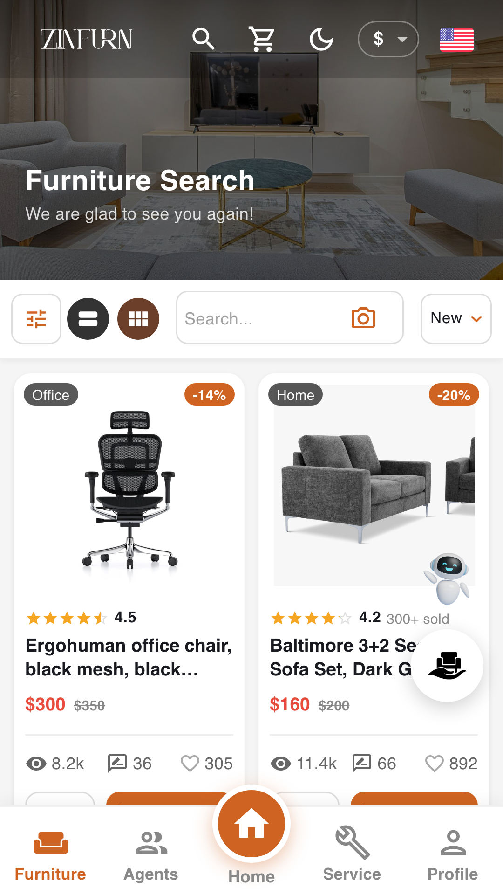
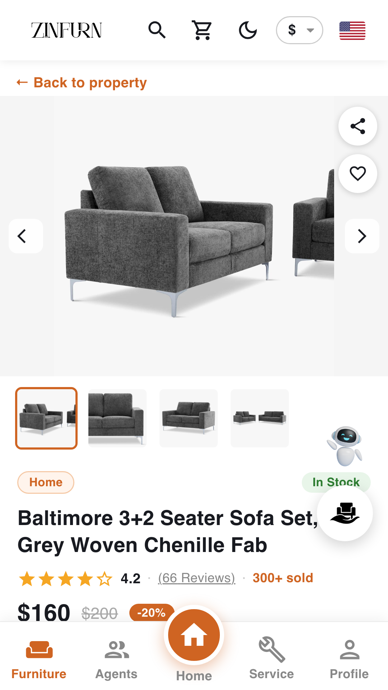
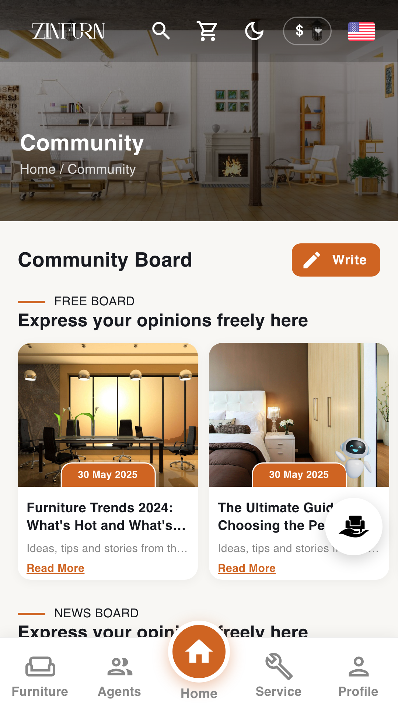

# Zinfurn — Android & iOS app

Native shell for the [Zinfurn furniture marketplace](https://zinfurn.uz), built with **Capacitor 8**. The app loads the live Next.js site (`server.url`) and adds native capabilities on top of it.

**Site:** [Zinfurn-Next](https://github.com/asadbek0512/Zinfurn-Next) · **API:** [Zinfurn](https://github.com/asadbek0512/Zinfurn) · **Android APK:** [zinfurn.uz/about#app](https://zinfurn.uz/about#app)

<p>
  
  
  
  
  
</p>

## Why a remote-URL shell

The frontend is Next.js Pages Router with SSR and `next-i18next` (5 locales), which cannot be statically exported. Instead of rewriting it, the app wraps the production site, so web and app ship from one codebase and every deploy reaches both instantly. `www/error.html` is shown when the device is offline.

## Native features

| Feature | How |
|---|---|
| Google / Apple sign-in | Google blocks OAuth inside WebViews (`disallowed_useragent`), so login opens in Custom Tabs / SFSafariViewController and returns via deep link; native Sign in with Apple on iOS |
| Longer sessions | The site detects the `ZinfurnApp/` user agent: 30-day sliding / 90-day max session (web: 10 h) |
| Biometric unlock | `@capgo/capacitor-native-biometric` |
| Push notifications | `@capacitor/push-notifications` (FCM / APNs), devices registered with the API |
| Native share, haptics, status bar, splash | official Capacitor plugins |
| iOS swipe-back | `allowsBackForwardNavigationGestures` on the WKWebView |

## Build

```bash
npm ci
npm run sync                                   # copy config + plugins to native projects

# Android (needs JDK 21 + Android SDK)
./scripts/android-release.sh <version>         # signed .aab + .apk

# iOS (needs Xcode + Apple Developer team)
./scripts/ios-release.sh <TEAM_ID> <version>   # archive + export .ipa
```

The release keystore and `android/keystore.properties` are git-ignored. Store listing and the full release checklist are in [`release/`](release/).
